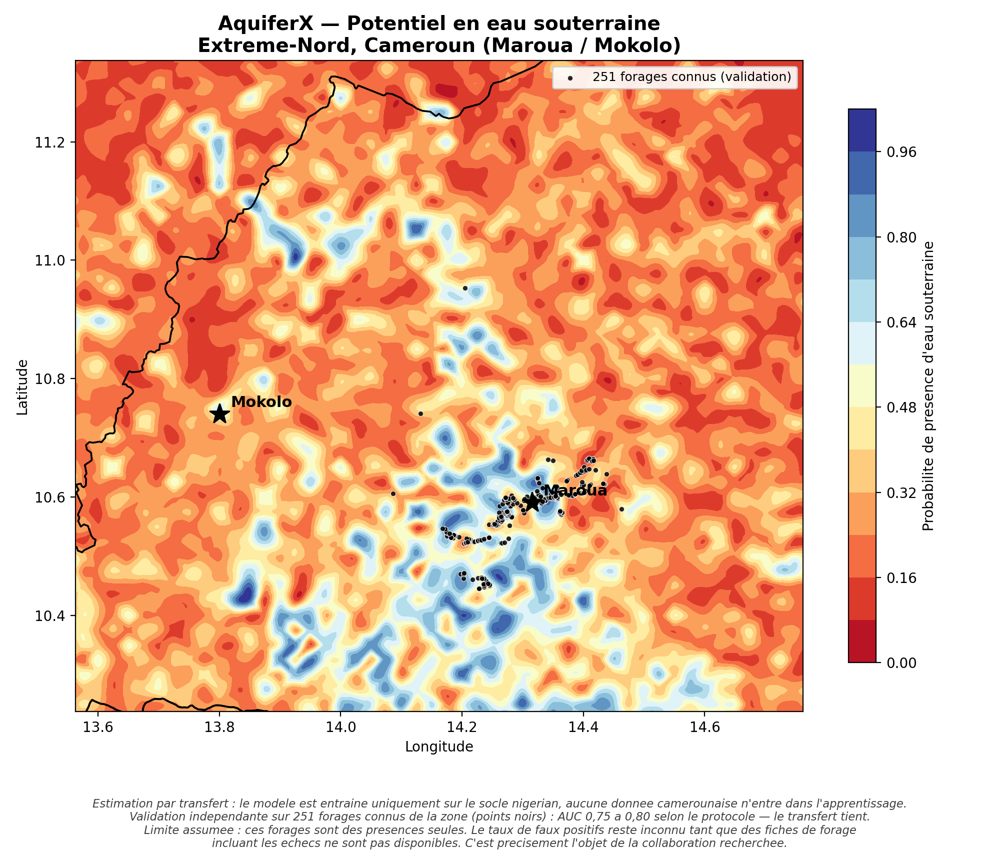
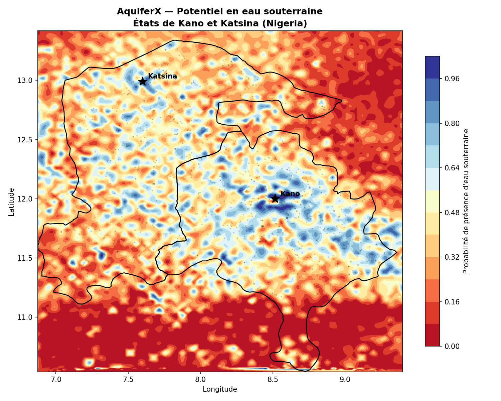

# AquiferX

**Cartographie du potentiel en eau souterraine par imagerie satellitaire et apprentissage automatique.**

AquiferX produit une carte probabiliste des zones favorables à la présence d'eau souterraine en zone de socle cristallin sahélien, à partir de données satellitaires librement accessibles et d'un modèle d'apprentissage automatique. L'objectif : réduire le risque de forer à sec, là où un forage sur trois à un sur deux ne donne pas d'eau.

> ⚠️ **Statut : preuve de concept.** AquiferX *oriente* la décision de forage ; il ne la remplace pas. Les limites sont documentées en détail plus bas — elles sont assumées, pas masquées.



---

## Le problème

En Afrique sahélienne, l'eau souterraine est la principale ressource d'alimentation en eau potable des populations rurales. Mais en zone de **socle cristallin** — granites et roches métamorphiques, où l'eau ne se loge que dans les altérites et les fractures — l'implantation d'un forage relève largement du pari : selon les études, **30 à 60 % des forages reviennent secs ou peu productifs**. Chaque échec représente des milliers d'euros et des mois perdus.

La connaissance existe pourtant dans les images satellite, librement accessibles. Le verrou n'est pas la donnée brute, c'est son exploitation : AquiferX transforme cette masse d'images en une information actionnable — une carte de potentiel.

---

## L'approche

| Étape | Méthode |
|---|---|
| **Données d'entraînement** | Points d'eau souterraine documentés (Water Point Data Exchange, WPdx), nord du Nigeria |
| **Variables explicatives** | 11 descripteurs satellitaires (relief, hydrologie, végétation, sol, climat) |
| **Modèle** | Forêt aléatoire (Random Forest, scikit-learn) |
| **Pseudo-absences** | Points tirés aléatoirement à ≥ 1 km de tout point d'eau connu |
| **Validation** | Validation croisée **spatiale par blocs** (neutralise l'autocorrélation spatiale) + analyse SHAP |
| **Transfert** | Modèle entraîné au Nigeria, appliqué à l'Extrême-Nord camerounais sans donnée locale d'apprentissage |

### Les 11 variables

Issues de jeux de données mondiaux via Google Earth Engine :

| Variable | Source | Rôle |
|---|---|---|
| `elevation`, `slope`, `curvature`, `tpi` | Copernicus DEM GLO-30 | Relief, position topographique |
| `flow_acc`, `twi` | HydroSHEDS | Accumulation des écoulements, humidité topographique |
| `ndvi`, `ndwi` | Sentinel-2 SR Harmonized | Végétation, humidité de surface |
| `rainfall` | CHIRPS | Pluviométrie cumulée |
| `sand`, `clay` | OpenLandMap | Texture du sol |

---

## Résultats

### Zone d'entraînement — Nord Nigeria (Kano / Katsina)

- **AUC ≈ 0,78** en validation croisée spatiale (12 649 points d'eau filtrés, sous-échantillonnés à 1 000).
- Variables les plus discriminantes (SHAP) : `ndwi`, `ndvi`, `elevation`, `tpi`, `rainfall`.



<details>
<summary>Contribution des variables (SHAP)</summary>


</details>

### Transfert géographique — Extrême-Nord Cameroun (Maroua / Mokolo)

Le modèle, entraîné **uniquement** sur le socle nigérian, a été confronté à **251 forages réels** de l'Extrême-Nord camerounais (extraits d'OpenStreetMap), à ~550 km de la zone d'entraînement.

| Protocole d'évaluation | AUC de transfert |
|---|---|
| A — fond aléatoire uniforme (optimiste*) | ~0,83 |
| **B — pseudo-absences appariées** (comparable au Nigeria) | **~0,78–0,80** |
| **C — appariées + blocs spatiaux** (le plus sévère) | **~0,72–0,79** |
| *Référence Nigeria (CV spatiale)* | *~0,78* |

\* *Le protocole A est biaisé par la forte agglutination des points OSM (indice de Clark-Evans R = 0,19) : à ne pas citer.*

**Le résultat est stable** : il ne varie pas significativement selon le protocole d'évaluation (fond aléatoire, pseudo-absences appariées, blocs spatiaux), ni selon la zone d'entraînement testée (Kano/Katsina, versant nigérian des Monts Mandara, ou les deux réunis — écart maximal 0,038, inférieur au bruit). **Le transfert géographique tient.**

---

## Limites (à lire absolument)

Ces limites conditionnent toute interprétation de la carte :

1. **Présences seules.** Les points d'entraînement et de validation indiquent où l'eau a été *trouvée*, jamais où elle a *manqué*. Le modèle sait reconnaître les zones favorables, mais son **taux de faux positifs — la probabilité qu'il désigne un site qui se révélerait sec — reste inconnu.** C'est le verrou qui sépare ce prototype d'un outil opérationnel.
2. **Biais anthropique.** Les points d'eau sont situés près des villages. Une partie du signal appris correspond donc à « être à proximité d'une zone habitée », et non strictement à l'hydrogéologie.
3. **Validation agglutinée.** Les 251 points camerounais sont fortement concentrés autour de Maroua et des axes accessibles (R = 0,19), reflet de la cartographie humanitaire. Ils couvrent une fraction de la zone cible.
4. **Plafond des données ouvertes.** Les performances ne progressent plus par l'ajout de variables ou le choix de la zone d'entraînement. Le levier suivant n'est pas algorithmique : ce sont des **fiches de forage réelles incluant les échecs**.

> **En une phrase : cette carte oriente ; elle ne décide pas.**

---

## Structure du dépôt

```
AquiferX/
├── aquiferx_poc.py              # Pipeline principal : entraînement + cartes Nigeria & Cameroun
├── osm_points_cameroun_v2.py    # Extraction des points d'eau OSM (API Overpass)
├── diagnostic_cameroun.py       # Diagnostic de couverture des bandes sur une zone
├── validation_cameroun_v3.py    # Validation du transfert (3 protocoles + indice d'agglutination)
├── test_mandara.py              # Comparaison proximité géologique vs volume de données
├── carte_cameroun_design.py     # Carte finale (relief ombré, encart de localisation)
├── images/                      # Cartes affichées dans ce README
├── data/                        # CSV d'entrée (WPdx, points OSM)
└── outputs/                     # Cartes et graphiques générés (PNG)
```

---

## Installation

**Prérequis :** Python 3.10+, et un compte [Google Earth Engine](https://earthengine.google.com/) (gratuit pour un usage non commercial).

```bash
# Dépendances
pip install earthengine-api scikit-learn pandas geopandas numpy scipy matplotlib shap requests

# Authentification Earth Engine (une seule fois)
earthengine authenticate
```

Dans `aquiferx_poc.py`, remplacez l'identifiant de projet Earth Engine par le vôtre :

```python
class Config:
    EE_PROJECT = "votre-projet-earth-engine"   # <-- à adapter
```

---

## Utilisation

```bash
# 1. Pipeline complet : entraîne le modèle et génère les deux cartes
python aquiferx_poc.py

# 2. Récupère les points d'eau OpenStreetMap de l'Extrême-Nord (pour la validation)
python osm_points_cameroun_v2.py

# 3. Valide le transfert géographique sur le Cameroun (3 protocoles)
python validation_cameroun_v3.py

# 4. (Optionnel) Teste proximité géologique vs volume de données
python test_mandara.py

# 5. Génère la carte finale soignée
python carte_cameroun_design.py
```

---

## Méthodologie — notes techniques

- **Validation croisée spatiale.** Les points sont partitionnés en blocs géographiques ; le modèle est évalué bloc par bloc. Cette approche évite la surestimation classique due à l'autocorrélation spatiale, qui gonfle les scores lorsqu'un point de test voisine un point d'entraînement.
- **Transfert sans fuite.** Aucune donnée camerounaise n'entre dans l'apprentissage : la validation sur l'Extrême-Nord mesure une véritable capacité de généralisation hors de la zone d'entraînement.
- **Interprétabilité.** L'importance des variables est quantifiée par valeurs SHAP, et non par la seule importance interne de la forêt aléatoire.
- **Reproductibilité.** Graine aléatoire fixée (`RANDOM_STATE`). *Note : la génération des pseudo-absences doit être semée explicitement pour une reproductibilité parfaite d'un run à l'autre.*

---

## Sources de données

- **Water Point Data Exchange (WPdx)** — points d'eau documentés, [waterpointdata.org](https://www.waterpointdata.org/)
- **OpenStreetMap** / Humanitarian OpenStreetMap Team — points d'eau de l'Extrême-Nord (via API Overpass)
- **Google Earth Engine** — Copernicus DEM GLO-30, Sentinel-2 SR Harmonized, CHIRPS, HydroSHEDS, OpenLandMap

---

## Feuille de route

- [ ] Intégrer des **fiches de forage réelles** (succès *et* échecs) pour calibrer localement et mesurer le taux de faux positifs — *priorité absolue*.
- [ ] Confronter la carte aux cartes hydrogéologiques de référence du Nord-Cameroun (zonage des taux de réussite).
- [ ] Enrichir les variables (densité de fracturation, épaisseur d'altérites, lithologie fine).
- [ ] Migrer vers le jeu `COPERNICUS/DEM/GLO30_2024_1` (le précédent est déprécié).

---

## Auteur

**Eugène Keumang Tchatat** — ingénieur-topographe & data scientist.
*Contributions, retours et pistes de données bienvenus.*

---

## Licence

À définir par l'auteur. Une licence permissive (MIT) est suggérée pour un projet de recherche ouvert ; ajoutez un fichier `LICENSE` à la racine.
